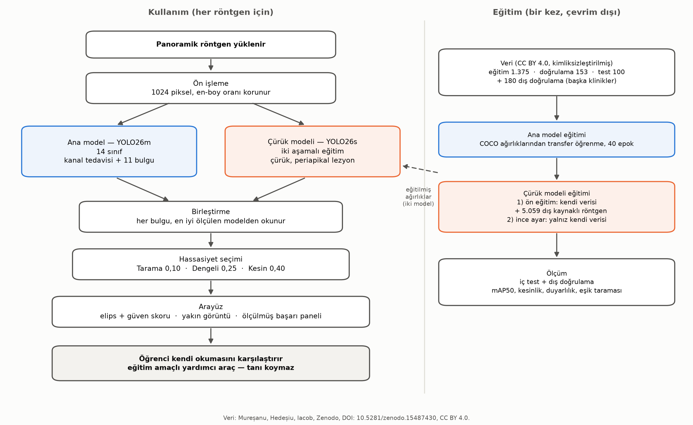
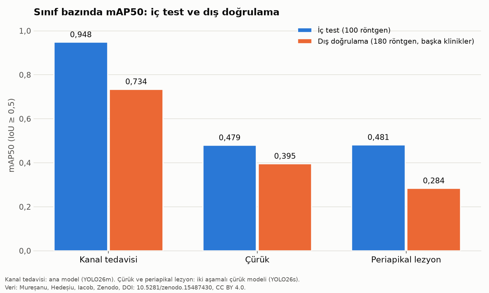

# Diş Röntgeni Analizi — Diş Hekimliği Öğrencilerine Destek Amaçlı Yapay Zekâ

Diş hekimliği öğrencilerinin panoramik röntgen değerlendirmesine destek olan yapay zekâ aracı:
röntgende 14 bulguyu (varsayılan olarak **çürük** ve **kanal tedavisi**) işaretleyen YOLO modeli,
her işaretin güven skoru ve modelin ölçülmüş başarısını gösteren web arayüzü.

- Çürük kırmızı, kanal tedavisi mavi elipsle işaretlenir; yanında `2. Çürük %78` gibi etiket çıkar.
- İstersen dolgu, kron/köprü, implant, periapikal lezyon, gömülü diş gibi bulgular da gösterilebilir (toplam 14 sınıf).
- Modelin test setindeki gerçek başarısı arayüzdeki **"Model ne kadar doğru?"** bölümünde yazar.

> ⚠️ Bu araç tanı koymaz. Diş hekimliği öğrencilerinin radyografi okumayı öğrenirken kendi okumalarını modelin işaretleriyle ve ölçülmüş güvenilirliğiyle karşılaştırabileceği, eğitim amaçlı bir yardımcı araçtır. Klinik kararda kullanılmaz.

### Bu depoda olmayanlar

- **Veri seti ve röntgen görüntüleri.** Veri setinin kullanım sözleşmesi veri setinin paylaşılmasına izin vermiyor; `prepare_data.py` veriyi kaynağından (Zenodo) indirir. Görüntüler yayınlayanlar tarafından kimliksizleştirilmiştir; depoda hiçbir hasta verisi yoktur.
- **Model ağırlıkları** (`weights/*.pt`). `train.py` ile yeniden üretilir.
- Ölçüm sonuçları `sonuclar/` klasöründe (JSON) ve eğitim grafikleri olarak yer alır.

## Kurulum

```bash
python -m venv .venv
.venv\Scripts\activate
pip install torch torchvision --index-url https://download.pytorch.org/whl/cu130
pip install -r requirements.txt
```

(Ekran kartı yoksa ilk satırdaki `--index-url` kısmını atlayın; model CPU'da da çalışır, sadece yavaştır.)

## Model nasıl eğitilir

**Seçenek A — kendi bilgisayarında (bu projede yapılan):**

```bash
python prepare_data.py               # veri setini indirir (1.4 GB) ve hazırlar
python train.py --nazik              # RTX 3060 6 GB'de ~1.5 sn/görüntü, 100 epoch ~2-4 saat
```

`--nazik` bayrağı: süreç önceliğini düşürür, VRAM'i sınırlar, batch'i 4'te (1024 piksel için ölçülmüş
güvenli değer, ~3.3 GB) ve işçi sayısını 4'te tutar; böylece eğitim sırasında bilgisayarı kullanabilirsin.

6 GB'lık kartta öğrenilen dersler:
- **Aynı anda başka bir eğitim/oyun çalıştırma.** İkisi 6 GB'a sığmayınca sürücü sistem belleğine taşıyor
  ve epoch süresi 30 dakikaya çıkıyor.
- `--batch -1` (otomatik) 1024 pikselde profilleme sırasında belleği taşırıp batch'i 1'e düşürebiliyor; sabit değer ver.
- Windows'ta her veri işçisi torch'u ayrı yükler (~900 MB). 8 işçi sistem belleğini tüketip eğitimi çökertti; 4 ideal.
- Eğitim yarıda kalırsa `python train.py --resume` kaldığı epoch'tan devam eder.

**Seçenek B — bulutta eğit (bilgisayar hiç yorulmasın):** `egitim_defteri.ipynb` hem Kaggle'da hem Colab'da çalışır.

*Kaggle (bilgisayarı kapatsan bile devam eder):*
1. [kaggle.com](https://www.kaggle.com) → **Create → Notebook** → *File → Import Notebook* → `egitim_defteri.ipynb`
2. Sağ panel: **Accelerator → GPU T4 x2**, **Internet → On** (bir kerelik telefon doğrulaması ister).
3. **Save Version → Save & Run All (Commit)** → sekmeyi kapat. Bitince *Output* sekmesinden `dis_modeli.zip`.

*Google Colab:*
1. [colab.research.google.com](https://colab.research.google.com) → **Dosya → Not defteri yükle** → `egitim_defteri.ipynb`
2. **Çalışma zamanı → Tümünü çalıştır.** (Defter GPU'yu kendi seçer; Drive izni isterse ver — bağlantı koparsa eğitim kaldığı yerden devam eder.)

Her iki durumda da ~2 saat sonra inen `dis_modeli.zip` dosyasını bu klasöre çıkarın →
`weights/best.pt` ve `weights/metrics.json` oluşur.

> GeForce NOW'da eğitim yapılamaz; orası sadece oyun akışı servisidir (Python çalıştıramazsın).

## Kullanım

**En kolay yol:** masaüstündeki **Diş Röntgeni Analizi** kısayoluna (ya da klasördeki
`Diş Röntgeni Analizi.bat` dosyasına) çift tıkla — tarayıcı kendiliğinden açılır.
Kapatmak için açılan siyah pencereyi kapatman yeterli.

```bash
python app.py                       # aynı arayüz, komut satırından
python predict.py rontgen.jpg       # tek tek işle, sonuclar/ klasörüne kaydeder
python predict.py klasor/ --conf 0.15 --all
python evaluate.py                  # modeli test + dış doğrulama setinde ölçer
```

**Güven eşiği:** arayüzdeki kaydırıcı (ya da `--conf`) sonucu belirgin şekilde değiştirir.
Tarama amaçlı bakarken **0.10-0.15** (hiçbir çürüğü kaçırma, birkaç fazladan işarete katlan),
kesin konuşurken **0.30-0.40**. Kanal tedavisi için varsayılan 0.25 zaten yeterli.

## Dosyalar

| Dosya | Ne yapar |
|---|---|
| `config.py` | Yollar, sınıf isimleri (TR), renkler, varsayılanlar |
| `prepare_data.py` | Veri setini indirir (paralel), MD5 doğrular, açar, `data/dental.yaml` yazar |
| `train.py` | YOLO eğitimi (`--model`, `--epochs`, `--imgsz`, `--resume`) |
| `evaluate.py` | Test + dış doğrulama ölçümü → `weights/metrics.json` |
| `detector.py` | Model yükleme, tespit, elips/etiket çizimi |
| `predict.py` | Komut satırı arayüzü |
| `app.py` | Gradio web arayüzü |
| `egitim_defteri.ipynb` | Kaggle/Colab eğitim defteri (proje dosyalarını içinde taşır) |

## Veri seti

Mureșanu S., Hedeșiu M., Iacob L. (2025). *Dataset for Automating Dental Condition Detection on Panoramic
Radiographs*, Zenodo, [doi:10.5281/zenodo.15487430](https://doi.org/10.5281/zenodo.15487430) — **CC-BY-4.0**.

1628 panoramik röntgen (Cluj-Napoca, Iuliu Hațieganu Üniversitesi; Vatech PCH-2500 cihazı), 3 kalibre araştırmacı
tarafından etiketlenmiş (gözlemciler arası uyum ICC = 0.91). Ayrı olarak **başka kliniklerden 180 röntgenlik
dış doğrulama seti** var — modelin farklı cihazlarda ne yaptığını görmek için önemli.

| Bölüm | Röntgen | Çürük | Kanal tedavisi | Toplam kutu |
|---|---|---|---|---|
| train | 1375 | 2745 | 2673 | 18570 |
| val | 153 | 407 | 224 | 1972 |
| test | 100 | 141 | 267 | 1369 |
| dış doğrulama | 180 | 296 | 528 | 2980 |

14 sınıf: implant, kron/köprü, dolgu, **kanal tedavisi**, **çürük**, kemik kaybı, gömülü diş, periapikal lezyon,
kök artığı, furkasyon lezyonu, apikal rezeksiyon, kök rezorpsiyonu, ortodontik aparey, cerrahi materyal.

## Sonuçlar

Sistem **iki modeli birlikte** kullanır: çürük ve periapikal lezyon `weights/curuk2.pt`'den,
kanal tedavisi ve diğer 12 bulgu 14 sınıflı `weights/best.pt`'den (YOLO26m) gelir.
Her bulgu, o bulguda en iyi ölçülen modelden okunur.

### Nihai performans (mAP50)

| Bulgu | İç test (aynı klinik) | Dış doğrulama (başka klinikler) |
|---|---|---|
| Kanal tedavisi | **0.948** | **0.734** |
| Çürük | 0.479 | 0.395 |
| Periapikal lezyon | 0.481 | 0.284 |

Kanal tedavisi için pratik karşılığı (dış doğrulama, eşik 0.15): gerçek kanal tedavilerinin
**%81'i** yakalanıyor, işaretlenenlerin **%70'i** doğru, röntgen başına 1,0 yanlış alarm.
Röntgen bazında: kanal tedavisi olan 120 röntgenin **116'sında (%97)** en az biri yakalanıyor.

### Çürük: tek model vs iki modelli sistem (dış doğrulama, 180 röntgen)

| Eşik | Tek model: bulma / doğruluk | **İki modelli: bulma / doğruluk** |
|---|---|---|
| 0.05 | %44 / %27 | **%49** / %27 |
| 0.10 | %36 / %43 | **%43** / %43 |
| 0.15 | %30 / %54 | **%36** / %55 |
| 0.25 | %21 / %69 | **%26** / %72 |
| 0.40 | %8 / %74 | **%12** / %90 |

Çürük mAP50 dış doğrulamada 0.320 → **0.395** (+%23), duyarlılık 0.308 → **0.389** (+%26).
Röntgen bazında: çürüğü olan röntgenlerin %60'ı yerine **%70'inde** en az bir lezyon yakalanıyor.

### Denenen yollar (hepsi ölçüldü)

| Deney | Sonuç |
|---|---|
| Çözünürlüğü 1280'e çıkarmak | **Fayda yok** — dış doğrulamada çürük 0.320 → 0.276, reddedildi |
| TTA (test anında artırma) | **Fayda yok** — eğri oynamıyor, sadece çalışma noktası kayıyor |
| 5.059 dış kaynaklı röntgeni eğitime karıştırmak | **Zararlı** — dış doğrulamada çürük 0.320 → 0.070 |
| Dış kaynaklı veriyle **ön eğitim** + kendi verimizle **ince ayar** | **İşe yaradı** — çürük 0.320 → **0.395** |
| Röntgeni 6 parçaya bölüp ayrı ayrı işlemek (tiling) | **Kısmen** — çürükte iç test +0.02 ama dış doğrulama −0.02; periapikal lezyonda her iki sette de en iyi (0.542 / 0.313). 6 kat yavaş olduğu için devreye alınmadı |
| **İki kat büyük model (YOLO26m, 40 epoch)** | **İşe yaradı** — kanal tedavisi iç test 0.931 → **0.948**, dış 0.707 → **0.734**; 13 sınıf ortalaması dışarıda 0.436 → 0.462. Ana model olarak alındı |

Kanal tedavisinde büyük modelin asıl kazancı yanlış alarmlarda: dış doğrulamada eşik 0.15'te
röntgen başına yanlış işaret 1.90'dan **1.03'e** indi, kesinlik %55'ten **%70'e** çıktı,
yakalama oranı aynı kaldı.

Ders: sorun veri miktarı değil, merkezler arası **etiketleme tutarsızlığı**. Yabancı veri doğrudan
karıştırıldığında model yabancı etiketleme stilini öğreniyor; önce ön eğitim sonra kendi verisiyle
ince ayar yapıldığında ise genel özellikleri alıp kendi stilimize uyum sağlıyor.

### Ana model (14 sınıf)

YOLO26s, 1024 piksel, 74 epoch (en iyi epoch 33), RTX 3060 Laptop 6 GB üzerinde ~4 saat.
Yanında aynı veriyle yayımlanan makalenin ([Diagnostics 2024, 14(20), 2336](https://doi.org/10.3390/diagnostics14202336))
YOLOv8 sonuçları:

**İç test seti (100 röntgen, aynı klinik)**

| Bulgu | Kesinlik | Duyarlılık | mAP50 | Makale (K / D) |
|---|---|---|---|---|
| Kanal tedavisi | 0.764 | 0.929 | 0.931 | 0.879 / 0.899 |
| Çürük | 0.687 | 0.333 | 0.486 | 0.626 / 0.511 |
| 14 sınıf ort. | 0.686 | 0.589 | 0.629 | mAP50 0.657 |

**Dış doğrulama (180 röntgen, başka klinikler ve cihazlar)**

| Bulgu | Kesinlik | Duyarlılık | mAP50 | Makale (K / D) |
|---|---|---|---|---|
| Kanal tedavisi | 0.562 | 0.799 | 0.707 | 0.734 / 0.777 |
| Çürük | 0.559 | 0.308 | 0.320 | 0.466 / 0.439 |
| 14 sınıf ort. | 0.535 | 0.479 | 0.436 | mAP50 0.451 |

Tablodaki kesinlik/duyarlılık, 14 sınıfın ortalama F1'ini en yükselten **tek** güven eşiğinde ölçülür.
Çürük için bu eşik yüksek kalıyor: model "çürük" dediğinde %69 haklı ama varsayılan eşikte çürüklerin
üçte birini işaretliyor. **Arayüzdeki eşiği 0.10-0.15'e çekince duyarlılık belirgin şekilde artar** —
bir test röntgeninde 0.25 eşiğinde 6 çürüğün 2'si, 0.10 eşiğinde 6'sı da bulundu.
Tarama için düşük eşik, kesin konuşmak için yüksek eşik.

Kanal tedavisi kolay (dolgu maddesi röntgende parlak ve belirgin), çürük zor: panoramik röntgende küçük,
düşük kontrastlı ve hekimler arasında bile tartışmalı olabiliyor. Düşük çürük skorları bu işin doğasında var.

## Şekiller

`python sekiller.py` rapor şekillerini `sekiller/` klasörüne üretir:

- `sekil1_akis.png` — sistemin akışı (kullanım ve eğitim adımları)
- `sekil2_map50.png` — iç test ve dış doğrulamada sınıf bazında mAP50 (değerler `weights/*.json` ölçüm dosyalarından okunur)
- `sekil3_ornek_cikti.png` — test setinden bir röntgende modelin çıktısı. Veri setinin görüntüsünü içerdiği için bu depoda yoktur.





> Veri: Mureșanu, Hedeșiu, Iacob, Zenodo, DOI: 10.5281/zenodo.15487430, CC BY 4.0.

## Sınırlar

- Model **panoramik** röntgen için eğitildi. Periapikal/bitewing (tek diş) filmlerde güvenilir çalışmaz.
- Tek bir merkezin cihazıyla çekilmiş görüntülerle eğitildi; başka cihazlarda başarı düşer (yukarıdaki dış doğrulama farkı).
- Çıktıdaki **%** değeri modelin güven skorudur, "bu diş %87 ihtimalle çürük" demek değildir.
- Tıbbi cihaz değildir; klinik kararda tek başına kullanılamaz.

## Nasıl daha iyi olur

- `python train.py --imgsz 1280` — çürükler küçük nesne, çözünürlük artınca genelde iyileşir (daha çok VRAM ister).
- `--model yolo26m.pt` — daha büyük model.
- Kendi kliniğinizin röntgenlerini etiketleyip (makesense.ai, Label Studio, CVAT) `data/dental_xray/train` altına eklemek
  en çok fayda sağlayan adımdır; model kendi cihazınıza uyum sağlar.
- Diş numaralandırma (FDI) eklemek için [DENTEX](https://huggingface.co/datasets/ibrahimhamamci/DENTEX) veri seti kullanılabilir.
